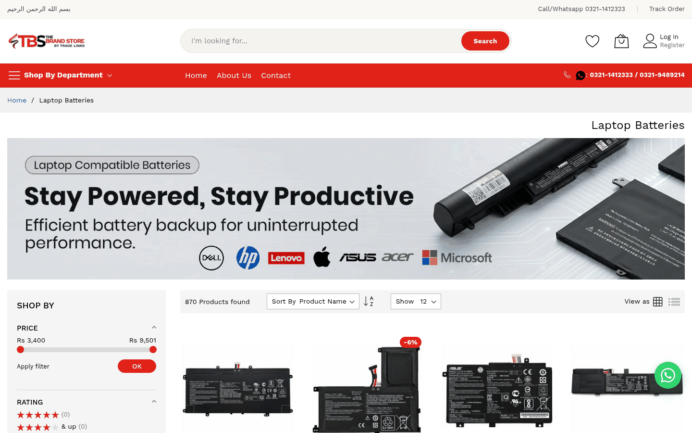

# The Brand Store

A Magento 2 e-commerce website for laptop batteries, chargers and parts, based in Lahore, Pakistan.

**Live site:** [www.thebrandstore.pk](https://www.thebrandstore.pk)

---

## Overview

The Brand Store is a retail website that supplies laptop batteries, chargers, keyboards and related parts to customers in Pakistan. I rebuilt and improved the live store, with an emphasis on helping customers identify the correct part, expanding the catalogue, and presenting the site more clearly.

This repository is a public showcase of that work. The source code remains private because the site is a live commercial store.

## Features

- **AI chat assistant.** A Botpress assistant that answers customer questions and provides links to live product pages.
- **Photo-based model finder.** Customers can photograph a laptop, battery or charger label. Optical character recognition runs in the browser and is built to accept HEIC photographs from iPhone cameras and to handle rotated images.
- **Parts-by-model search.** A search flow that helps customers find compatible parts for a given laptop model, with a brand filter.
- **Interface redesign.** The header, menu and footer were redesigned for a clearer layout.
- **Catalogue.** The product catalogue was expanded with product photographs and search-engine-oriented descriptions.
- **Customer contact.** Floating WhatsApp and live-chat controls are placed on the storefront so that customers can reach the shop without leaving the page.

## Screenshots

### Homepage (desktop)

### Homepage (mobile)

### Laptop Batteries category

### Product page

## Technical Stack

**Platform:** Magento 2, PHP, JavaScript  
**Assistant and recognition:** Botpress; in-browser optical character recognition in the style of Tesseract.js  
**Infrastructure:** Cloudflare

## Source Code

The source code for the live store is private. The public website is the definitive view of the project:

[www.thebrandstore.pk](https://www.thebrandstore.pk)
