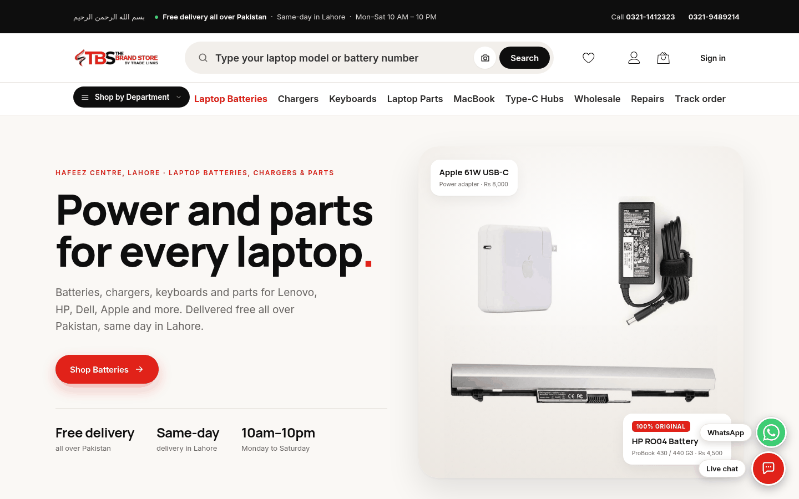
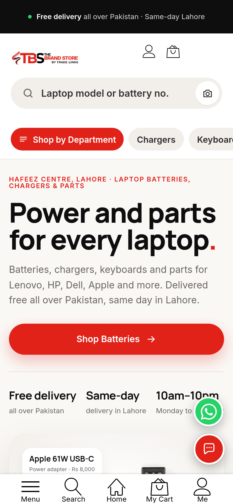
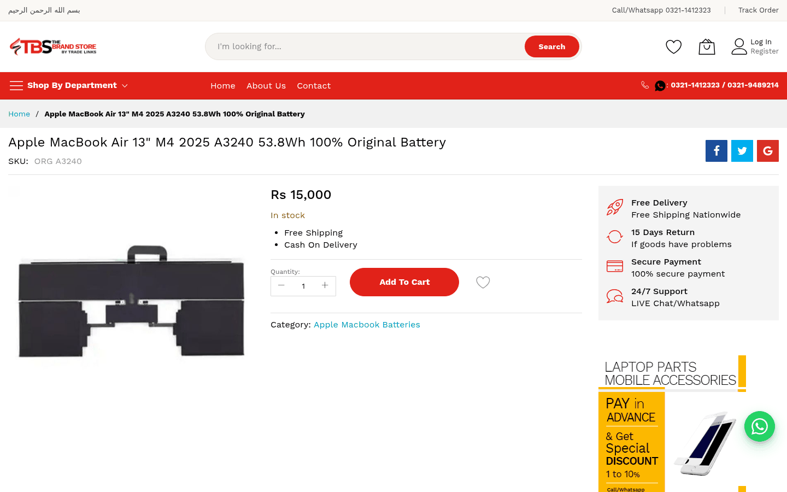

# The Brand Store

A Magento 2 e-commerce website for laptop batteries, chargers, keyboards and related parts, based in Lahore, Pakistan.

**Live site:** [www.thebrandstore.pk](https://www.thebrandstore.pk)

This repository is a public showcase of work on the live store. The source code remains private because the site is a commercial shop.

## Screenshots

### Homepage (desktop)

### Homepage (mobile)

### Laptop Batteries category

### Product page

## Features

- **Parts-by-model search.** On the homepage, a customer chooses a brand and types a laptop model. Matching batteries, chargers, keyboards and other parts are listed together, limited to the selected brand.
- **Photo-based model finder.** A customer can photograph a battery or charger label. Optical character recognition runs in the browser with Tesseract.js, including pre-processing for rotation and low-contrast or blurred labels. If the label cannot be read, the photo can be sent on WhatsApp instead.
- **AI chat assistant.** A Botpress assistant is available from a live-chat control on the storefront. If the assistant cannot load, the same control offers WhatsApp.
- **Customer contact.** The storefront shows WhatsApp and phone contact for ordinary enquiries (0321-1412323) and a separate wholesale enquiry route. Order-on-WhatsApp links appear on product cards.
- **Interface.** The header, navigation, footer and homepage were redesigned for a clearer layout.
- **Catalogue.** Product pages were expanded with photographs and search-oriented descriptions.

The shop is at Hafeez Centre, Gulberg III, Lahore. The live site lists cash on delivery, free delivery within Pakistan, and same-day delivery in Lahore.

## Tech stack

**Platform:** Magento 2, PHP, JavaScript (MageBig Martfury theme, with custom storefront scripts and styles).  
**Recognition and assistant:** Tesseract.js (in the browser); Botpress.  
**Infrastructure:** Cloudflare in front of the live store.

## How to view it

There is no public installation or build step. The live website is the project:

[www.thebrandstore.pk](https://www.thebrandstore.pk)

## Roadmap

- Improve how reliably the photo-based finder reads difficult labels.
- Keep product photographs and descriptions current as the catalogue changes.

## Author

Work on the live store by Kinza Amjad. [LinkedIn](https://www.linkedin.com/in/kinzaamjadd)
